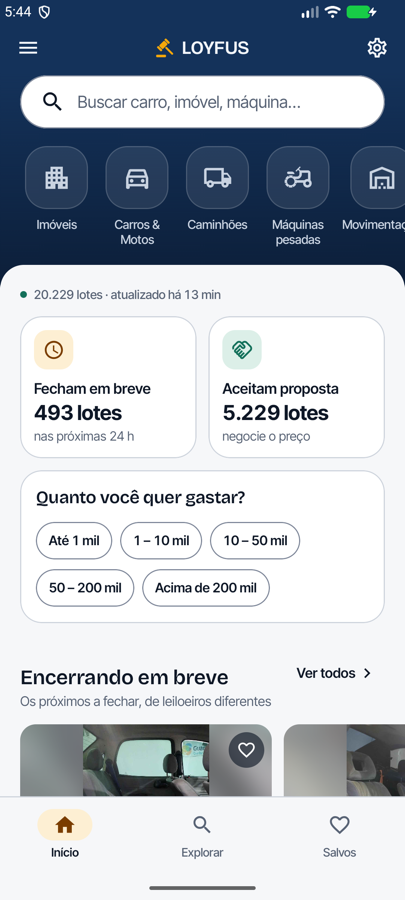
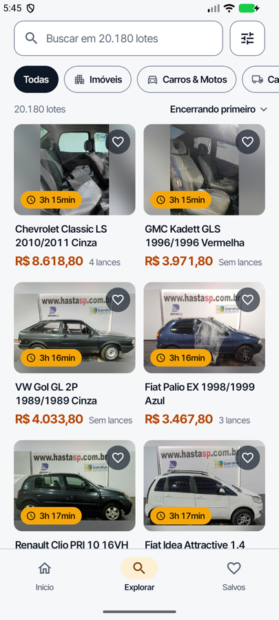
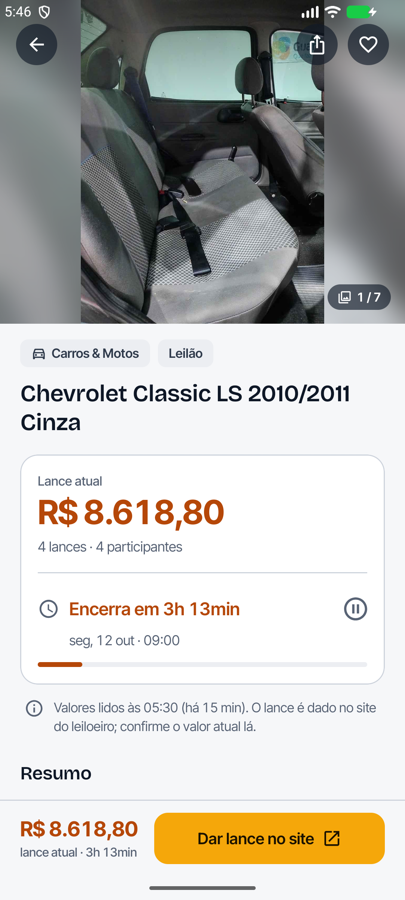
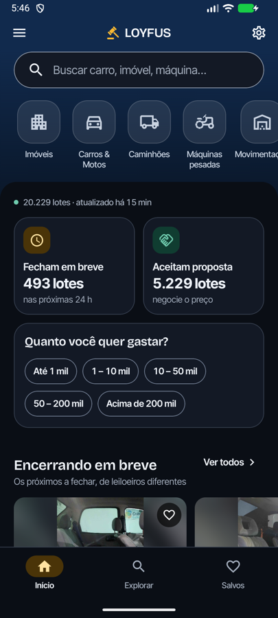

<p align="center">
  
</p>

<h1 align="center">Loyfus · Android</h1>

<p align="center">
  <b>Catálogo de leilões brasileiros com dados reais.</b><br>
  <sub>Kotlin · Jetpack Compose · Material 3 · MVVM com StateFlow</sub>
</p>

<p align="center">
  
  
  
  
  
</p>

---

## O app

Lote de leilão no Brasil tem um problema antigo: o preço está espalhado por dezenas de
portais, o título vem em CAIXA ALTA com código de anúncio no meio, e o prazo fica escondido.
O Loyfus junta isso num catálogo só — e cada lote guarda a **URL de origem**, então o arremate
sempre acontece no site do leiloeiro, nunca dentro do app.

**20.229 lotes**, **1.366 leilões**, **19 categorias** e **141.304 fotos** — coleta real,
verificada numa rodada completa contra a fonte pública.

<table>
  <tr>
    <td width="32%"><br><sub>Inicial — vitrines montadas no servidor</sub></td>
    <td width="32%"><br><sub>Explorar — filtro e prazo ao vivo</sub></td>
    <td width="32%"><br><sub>Lote — decisão, origem e lance</sub></td>
  </tr>
  <tr>
    <td colspan="3" align="center"><br><sub>Tema escuro desenhado, não invertido</sub></td>
  </tr>
</table>

## O que ele faz

- **Inicial** — busca, atalhos de categoria e quatro vitrines montadas no servidor:
  *Encerrando em breve*, *Mais disputados*, *Acabaram de chegar* e *Imóveis*. Mostra há
  quanto tempo o catálogo foi atualizado.
- **Explorar** — busca com debounce, categorias, folha de filtros (tipo, prazo, faixa de
  preço, ordenação), tags removíveis e contagem ao vivo. O estado sobrevive à troca de aba.
- **Lote** — galeria com zoom, card de decisão com lance atual e prazo, resumo, ficha técnica,
  condições e edital. **Barra fixa com o botão que leva ao site do leiloeiro.**
- **Salvos** — favoritos anônimos por `device_id`, agrupados por urgência, com desfazer.

## Decisões

**1. O backend monta as vitrines.** `/api/v1/home` devolve as quatro prateleiras já
montadas, com um lote por leiloeiro e em ordem de prazo. O app não orquestra consulta: ele
decodifica. Isso mantém a inicial em uma chamada e deixa a regra de "não mostrar três lotes
do mesmo leiloeiro" num lugar só.

**2. O app não joga.** Todo lote tem `web_url` e o botão de lance abre o site do leiloeiro.
Um app de leilão que simula lance ensina a pessoa a perder dinheiro; a nota de origem —
*"valores lidos às 14:32"* — fica na tela para deixar isso explícito.

**3. As regras são espelhadas no iOS de propósito.** Formatação de preço em pt-BR,
contagem regressiva e limpeza de título existem em Kotlin **e** em Swift, testadas contra o
mesmo golden de 1.566 títulos reais. Uma divergência entre os dois clientes vira teste
vermelho em vez de surpresa em produção.

## Arquitetura

```
app/src/main/java/br/com/loyfus/
├── core/      formatação, limpeza de título, buscas recentes — espelhado no iOS
├── data/      cliente HTTP (OkHttp + kotlinx.serialization), repositório e stores
└── ui/        composables, telas (inicial, explorar, lote, salvos, ajustes) e o tema
```

O estado desce como `StateFlow` e a tela não conhece HTTP. `data/` é a única pasta que sabe
que existe uma API — trocar o cliente não toca em nenhum composable.

## Rodar

A API precisa estar no ar. O repositório `loyfus-backend` sobe com Docker:

```bash
docker compose up -d
```

Depois, no projeto Android:

```bash
export JAVA_HOME=/opt/homebrew/opt/openjdk@17
export ANDROID_HOME=~/Library/Android/sdk

# aponta o loopback do dispositivo na API da maquina
~/Library/Android/sdk/platform-tools/adb reverse tcp:8080 tcp:8080

./gradlew :app:installDebug
```

Para um dispositivo físico, aponte a base na compilação:

```bash
./gradlew :app:assembleDebug -PloyfusApiBaseUrl=http://192.168.0.10:8080
```

## Testes

```bash
./gradlew :app:testDebugUnitTest
```

Cobrem o que o leitor perceberia se estivesse errado: **preço em pt-BR** (milhar com ponto,
decimal com vírgula), **contagem regressiva** e a **forma do JSON** que a API devolve. O
teste de limpeza de título roda contra o golden compartilhado com o iOS — 1.566 títulos
reais que precisam voltar **exatamente** iguais.

## Deep link

`loyfus://lot/<id>` abre o lote e `loyfus://explore` abre a busca, com o mesmo contrato nas
duas plataformas — um link de qualquer lugar cai na tela certa.

## Stack

| | |
|---|---|
| Linguagem | Kotlin 2.4.21 · Java 17 |
| UI | Jetpack Compose (BOM 2026.09) · Material 3 |
| Arquitetura | MVVM · `StateFlow` · Navigation Compose |
| Rede | OkHttp 5.5 · kotlinx.serialization 1.11 |
| Imagem | Coil 3.6 |
| Build | AGP 9.4.1 · minSdk 26 · targetSdk 37 · R8 no release |

## Licença

MIT — [LICENSE](LICENSE).

---

Parte de um projeto de três repositórios: [`loyfus-backend`](https://github.com/loyfus/loyfus-backend)
(crawler + API + banco) e [`loyfus-ios`](https://github.com/loyfus/loyfus-ios) (SwiftUI).
Nenhum cliente depende do código do outro — só do contrato HTTP.

<sub>Dados de coleção: SuperBid, via endpoints públicos consumidos pela própria vitrine do site.</sub>
